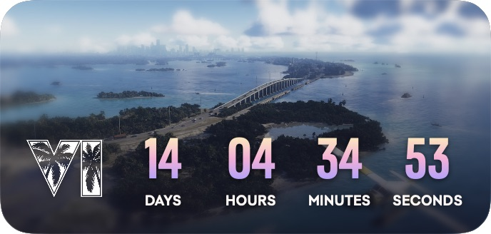

<p align="center">
  
</p>

# VI Countdown

一款为 macOS 制作的 GTA VI 桌面倒计时小组件。白色棕榈叶 VI 标志、粉紫渐变数字、轮换背景，以及归零时的霓虹欢迎动画。

**[下载最新版本](https://github.com/Humb1GoDH/VI-Countdown/releases/latest)** · [查看所有版本](https://github.com/Humb1GoDH/VI-Countdown/releases)



*截图中的剩余时间仅为拍摄时的示例，程序会根据当前时间实时计算。*

## 下载与安装

1. 打开上方下载页面，在 **Assets** 中下载 `VI-Countdown-v1.1-macOS-arm64.zip`。
2. 解压后，将 `VI Countdown.app` 拖入“应用程序”文件夹。
3. 双击打开。右键卡片可调整设置，菜单栏的 `VI` 可重新显示卡片。

**系统要求**：Apple Silicon Mac（M 系列芯片），macOS 15 或以上。当前安装包不支持 Intel Mac。

当前版本使用临时签名，尚未经过 Apple Developer ID 签名和公证。首次打开时，macOS 可能提示无法验证开发者；相关系统提示与处理方法请参阅 [Apple 官方说明](https://support.apple.com/zh-cn/102445)。

## 功能

- 344 × 164 pt 原生悬浮窗，可拖动、记住位置，并切换置顶。
- 四列实时倒计时：`DAYS`、`HOURS`、`MINUTES`、`SECONDS`。
- 固定目标时间为 **北京时间 2026 年 11 月 19 日 00:00（UTC+8）**，不会随系统时区改变。
- 内置 12 张背景，每 15 分钟随机轮换，支持暂停、下一张和修改间隔。
- 倒计时归零后播放约 12 秒的 VI 霓虹动画，随后显示 **WELCOME TO LEONIDA / OUT NOW**。
- 右键可提前预览动画，并返回倒计时；提前预览不会影响到期时的自动播放。
- 图片、字体与动画均随应用提供，断网可用，默认无声音。
- 支持系统“减少动态效果”设置。

## 版本 1.1

接入发售动画与欢迎卡片，保留白色棕榈叶 VI 应用图标。正式动画播放完成后会记住状态；如果错过倒计时终点，首次打开时会补播。

安装包 SHA-256：

```text
48f221c469c4f3f90c85daf94562ef52e5c93b15efd687badd38e8a97f400c42
```

## 关于

这是非官方个人项目，与 Rockstar Games 无隶属关系。本仓库用于提供软件说明与安装包下载。

GTA VI 的标志、图片与字体来自 Rockstar Games 官方素材，相关权利归原权利人所有。[GTA VI 官网](https://www.rockstargames.com/VI)
